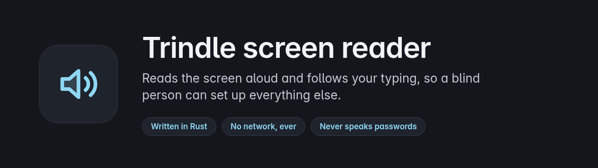
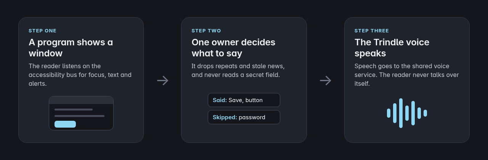

<p align="center">
  
</p>

<p align="center">
  
  
  
  
</p>

Trindle screen reader reads what is on the screen aloud, follows the caret as you type, and lets you move around a window with the keyboard. It is written in Rust, and it is the one plugin that comes preinstalled on Trindle, so a blind person can set up everything else.

It talks to programs through the accessibility bus (AT-SPI) and speaks through the shared Trindle voice service. It opens no network connection, never reads out a password, and has one owner for speech so it never talks over itself. It is a beta: it has not yet been tried by blind testers, so do not make it the only way into a computer yet.

## How it works

<p align="center">
  
</p>

## Quick start

You need Rust 1.89 or newer (the clippy check needs a toolchain with clippy installed at that version or later), a running accessibility bus, and the Trindle voice service if you want sound. The compositor sends the reader its keys. The release build for Trindle is `packaging/trindle-plugin.sh`, which removes this computer's folder names from the program. The licences of the Rust crates built into the program are in `share/licences/THIRD-PARTY.txt`.

```bash
cargo build --release
./target/release/trindle-screen-reader start
```

`start` runs a small watcher that keeps the reader running and restarts it if it stops. The other commands:

```bash
trindle-screen-reader status      # says running or not running
trindle-screen-reader stop
trindle-screen-reader run         # in the foreground; add --text to print instead of speak
trindle-screen-reader dry-run scenario.toml
trindle-screen-reader cues DIR    # write the sound cues as files
```

`run --text` is the easy way to see what the reader would say without a voice service. If the voice service is missing, the reader plays a low double tone every 30 seconds and writes the fault to its log, so a missing voice is never silent.

## What it does

- Speaks focus changes, windows, dialogs, alerts and notifications, with a short or a full description.
- Follows the caret and echoes typing by character, by word, by both or not at all.
- Says where you are, repeats the last thing said, spells it, and keeps a history.
- Reads on with say all, with commands to skip a sentence or a paragraph.
- Reviews the screen as flat text by line, word and character, without moving the real caret.
- Plays short sounds for windows, alerts, notifications and secret fields, at their own volume.
- Has a first browse mode: a cursor that moves through a window in reading order, jumps by heading, link, list, table, landmark, form field, button or graphic, element lists, focus mode for fields, and the program's own focus follows the cursor onto controls.
- Has a learn mode, layers for review, settings and browse, and a laptop layout with letters instead of a number pad.
- Starts in a login-screen mode and hands over to the person's own reader through a lock file, so two readers never run at once.

Say all and review are tested with scripted sessions. Gathering the objects of a window for review was checked on 28 October against a live Toolkit window (three objects, with their places and the focused one). Triggering them with the compositor's real keys is not yet checked. Browse mode was also checked live on 28 October on the same window. It is reached with the reader key then B. It stays open for plain single-letter keys when the compositor says it can hand them over; until then it takes one key at a time. Not built yet: the lock screen and braille.

The keys, browse mode, settings and fixes are in [docs/HELP.md](docs/HELP.md).

## Settings

Every setting can be changed from the reader's settings layer (the reader key with G) and is saved at once. They live in a plain file, `~/.config/trindle-screen-reader/settings.toml`, which you can also edit. None is required. A value it does not understand is replaced by a safe one and the reader says so, and one bad value never throws away the good ones.

| Setting | Required | Default | What it does |
|---|---|---|---|
| `verbosity` | no | `brief` | `brief` or `verbose` descriptions. |
| `typing_echo` | no | `both` | `none`, `character`, `word` or `both`. |
| `rate` | no | `50` | Speaking speed, 0 to 100. Never lower than 10, so no setting makes it unusably slow. |
| `volume` | no | `100` | Speech volume, 0 to 100. |
| `sounds` | no | `true` | Short sounds for windows, alerts, notifications and secret fields. |
| `cue_volume` | no | `60` | Sound volume, 0 to 100, separate from speech. |
| `laptop_layout` | no | `false` | Letters and punctuation for review, for keyboards with no number pad. |

## Where your data lives

The settings file above. The sound cue files and a short log are kept in `$XDG_RUNTIME_DIR/trindle-screen-reader` (the log is in `log`), because with no voice it is the only place a fault shows. Nothing is sent anywhere.

These environment variables are read, mostly by the system rather than by you: `TRINDLE_VOICE_SOCKET` (the speech service's socket), `TRINDLE_SR_CONFIG` (settings file path), `TRINDLE_SR_CONTEXT` (`greeter` when started by the login screen), `TRINDLE_SR_HANDOVER_LOCK` (the login hand-over lock path) and `TRINDLE_SR_RESTARTED` (set by the watcher when it restarts the reader).

## Security

- It never speaks a password or the text of a secret field, and never fetches it.
- It never uses the network.
- The key socket in `$XDG_RUNTIME_DIR/trindle-screen-reader` accepts only the same user, one compositor at a time, and trusts keys as real only from the compositor's own program.

To report a security problem privately, read [SECURITY.md](SECURITY.md).

## Building it yourself

```bash
cargo build --release
cargo test
```

The tests need no screen, no bus and no voice. `tests/pipeline.rs` runs scripted sessions end to end, and `tests/hostile.rs` feeds the reader badly behaved programs. The messages to the voice service are in `VOICE-INTERFACE.md`.

## Reporting bugs

Report bugs and crashes on the [Buildmorphic community](https://buildmorphic.com). See [CONTRIBUTING.md](CONTRIBUTING.md).

## Licence

Trindle screen reader is free software under the GNU General Public License, version 3 or later, held by the Trindle project. Every version falls under that licence. The full text is in [LICENSE](LICENSE). Changes are listed in [CHANGELOG.md](CHANGELOG.md).

## Disclaimer

This software is provided as it is, without any warranty. It is early software that blind testers have not yet used, and it should not be your only way of using a computer until they have.

Comments are stripped from the published code to keep it lean.
